# Design v3 – Etappe 1 (Schrift, Stufen, Navigation) – Vorher / Nachher

Nur Testdaten (Skript `jarvis/screens/demo-screens.js`). Hinweis: In der Test-Umgebung lädt Google Fonts nicht,
darum zeigen die Bilder eine Ersatzschrift statt Saira. Auf dem iPhone erscheint Saira (kursiv, schmal).

| Screen | Vorher | Nachher |
|---|---|---|
| Übersicht (dunkel) | 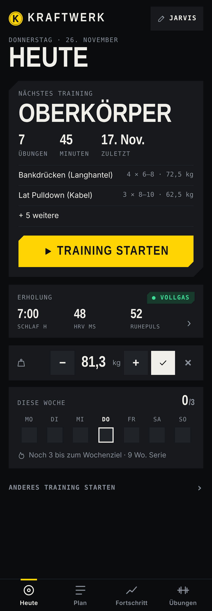 | 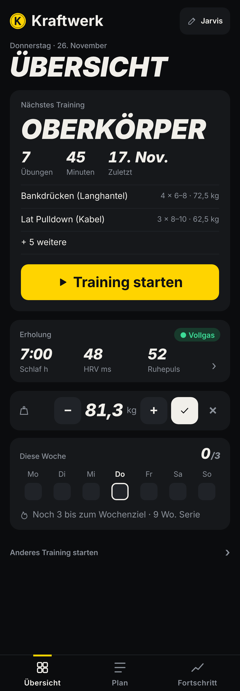 |
| Plan (dunkel) | 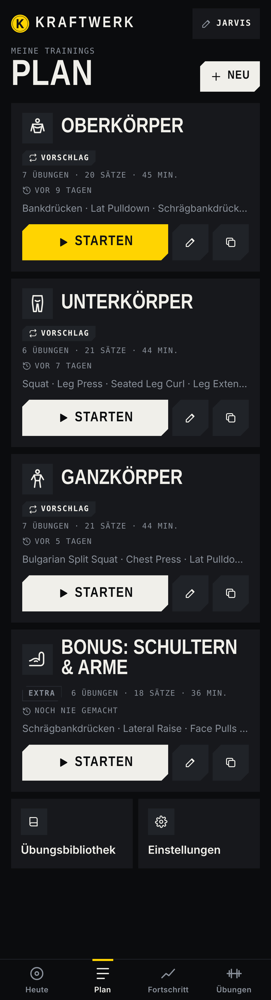 | 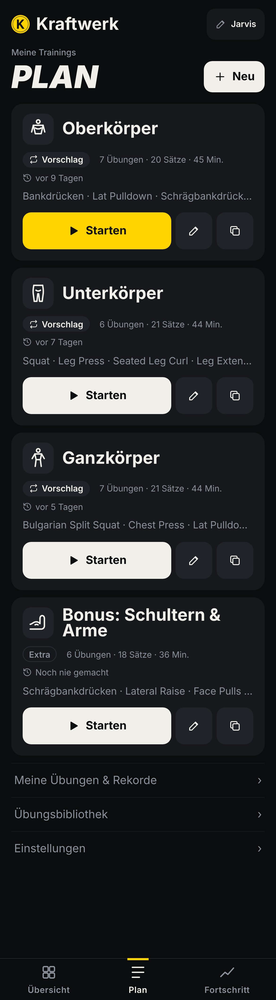 |
| Fortschritt (dunkel) | 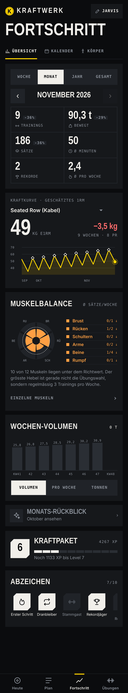 | 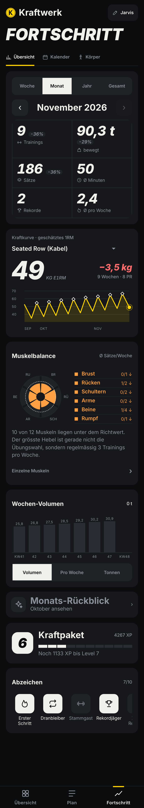 |
| Training (dunkel) | 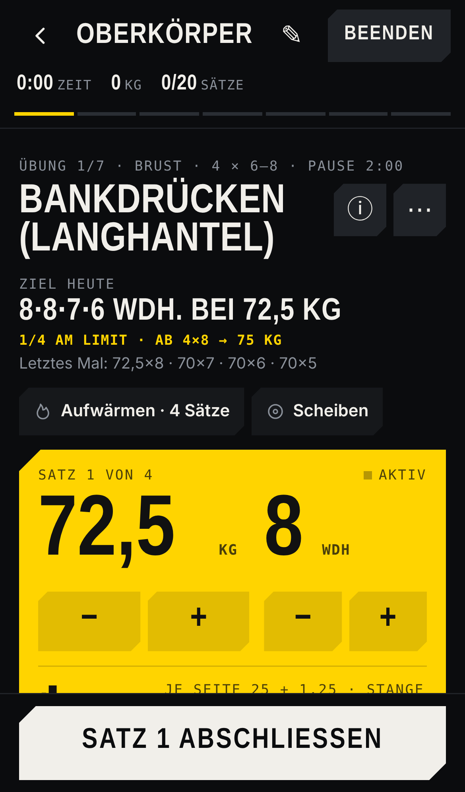 | 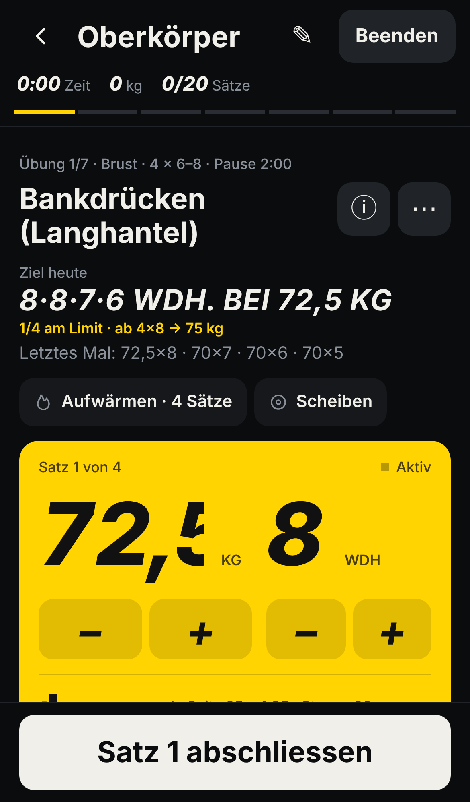 |
| Übersicht (hell) | 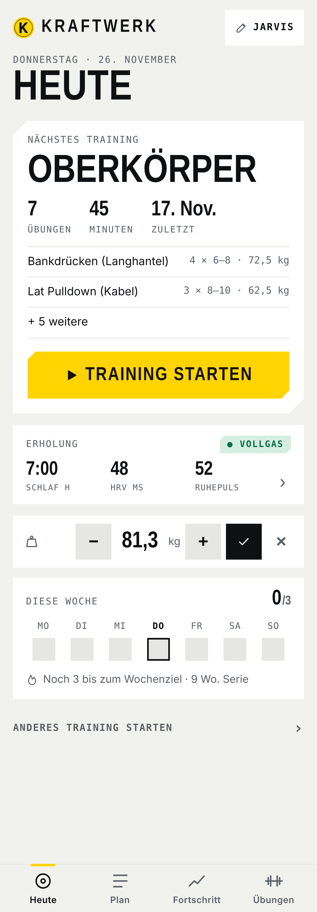 | 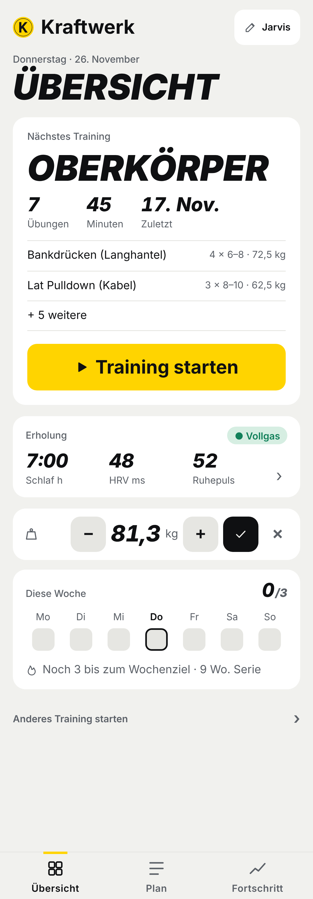 |
| Plan (hell) | 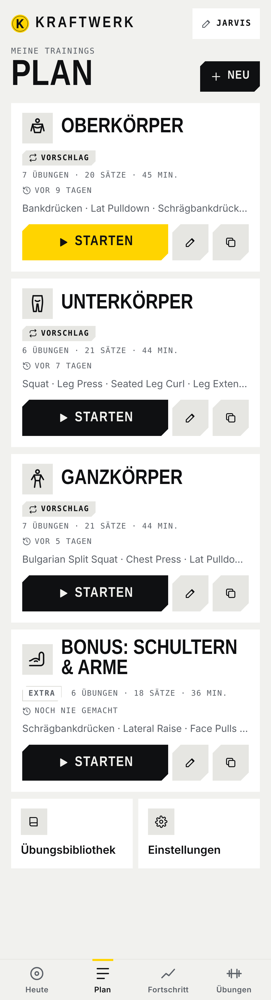 | 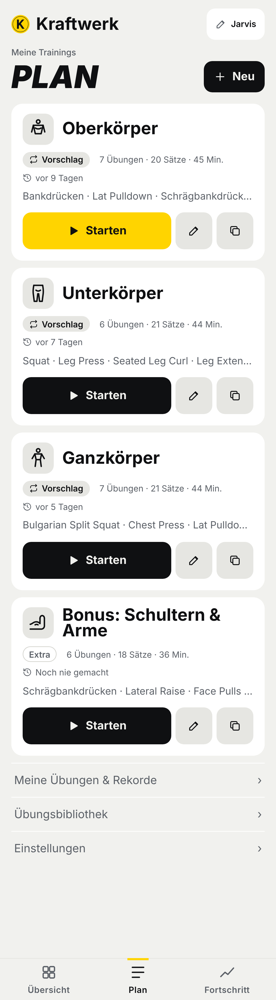 |
| Fortschritt (hell) | 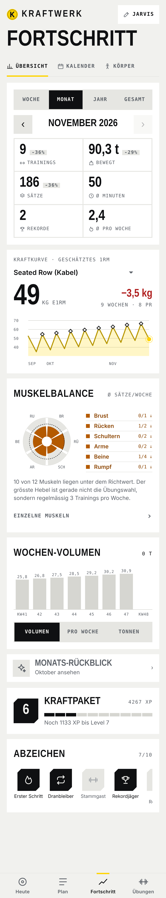 | 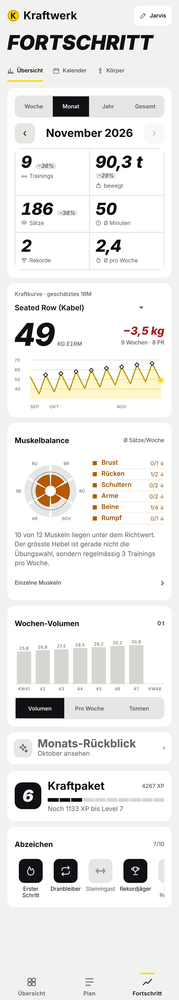 |
| Training (hell) | 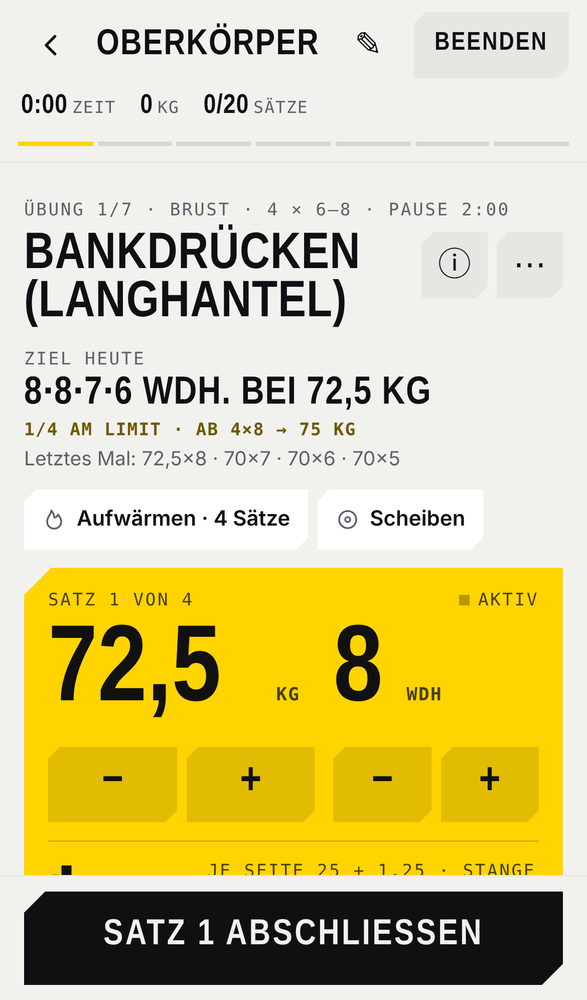 | 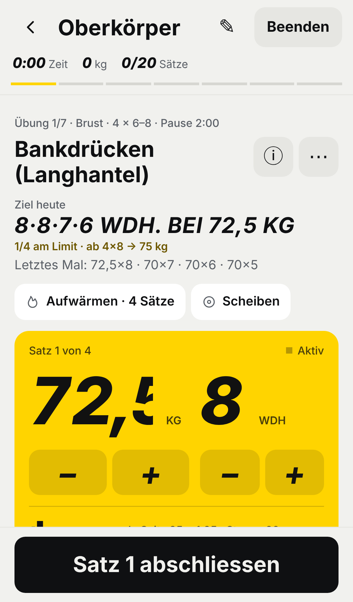 |
