# Design v2 ruhiger – Vorher/Nachher (26.11.2026)

Screenshots mit **reinen Testdaten** (erfundene Trainings, Gewichte und Garmin-Werte), iPhone 13, hell und dunkel.
«Vorher» = Stand vor PR #22, «Nachher» = nach PR #22 und dem Design-PR vom 26.11.
Die Webfonts liessen sich in der Testumgebung nicht laden; auf dem iPhone sind die Schriften schmaler.

| Screen | Vorher | Nachher |
|---|---|---|
| Heute (hell) | 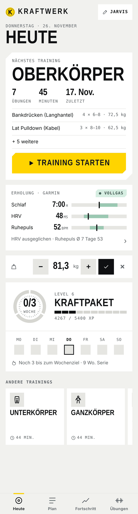 | 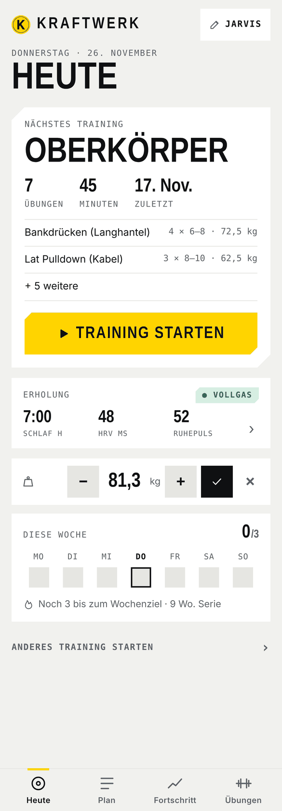 |
| Training (hell) | 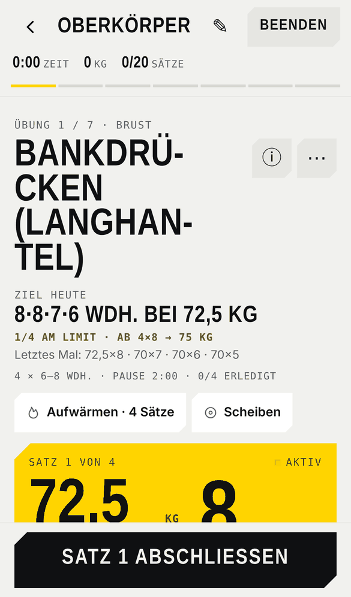 | 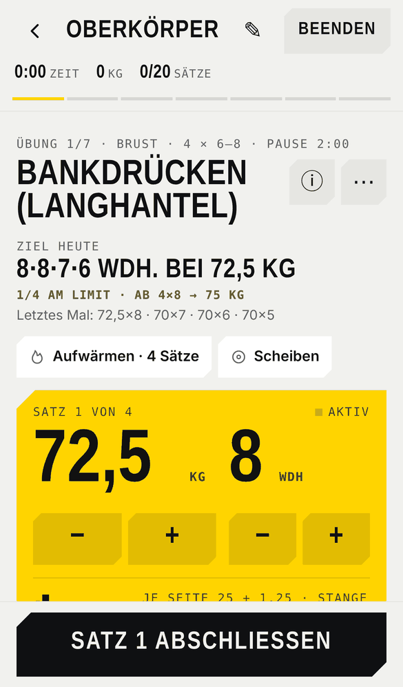 |
| Plan (hell) | 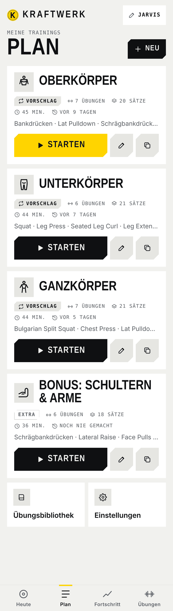 | 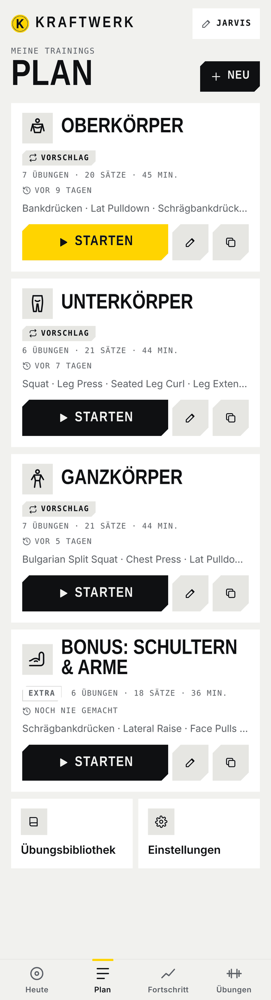 |
| Fortschritt (hell) | 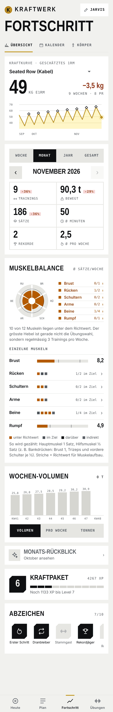 | 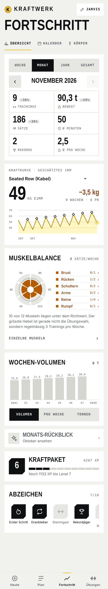 |
| Heute (dunkel) | 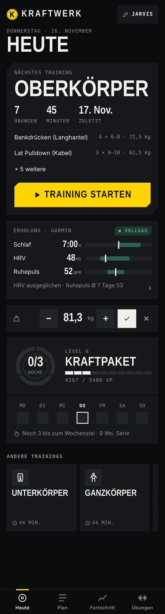 | 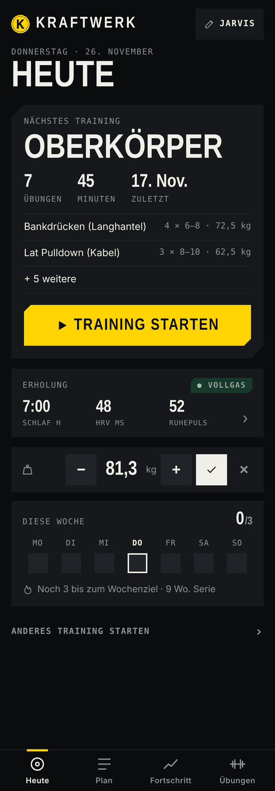 |
| Training (dunkel) | 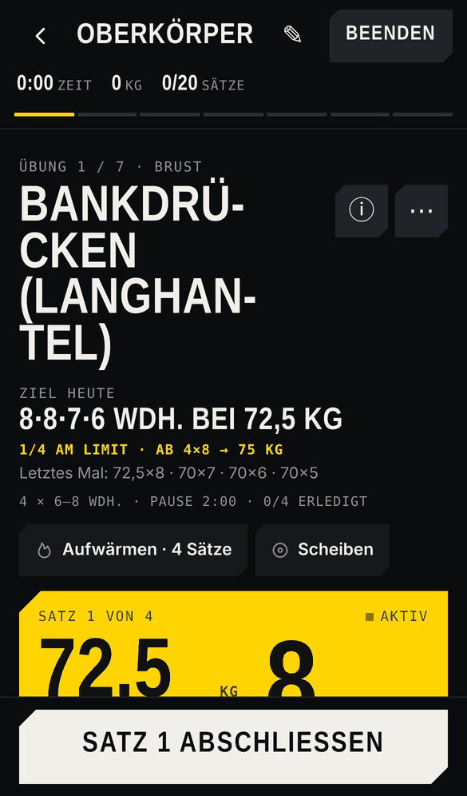 | 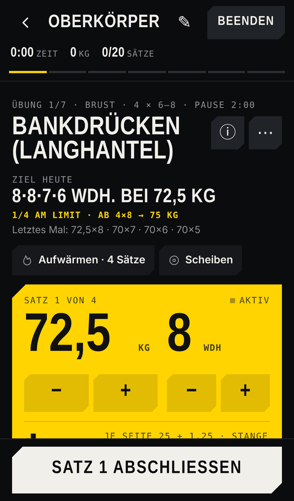 |
| Plan (dunkel) | 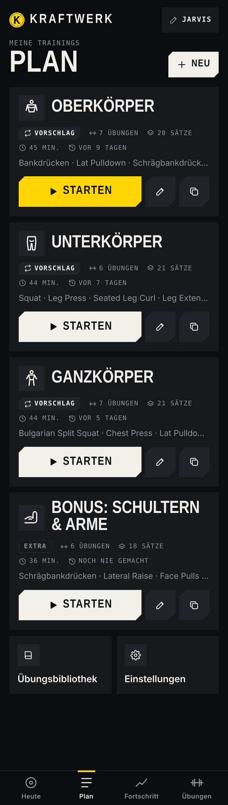 | 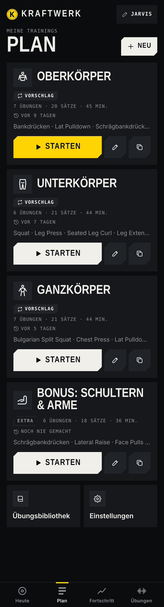 |
| Fortschritt (dunkel) | 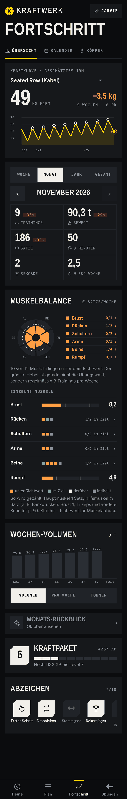 | 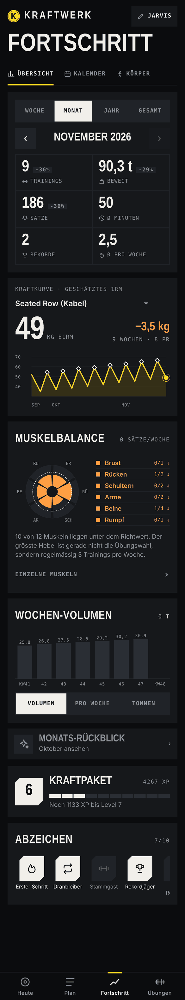 |
