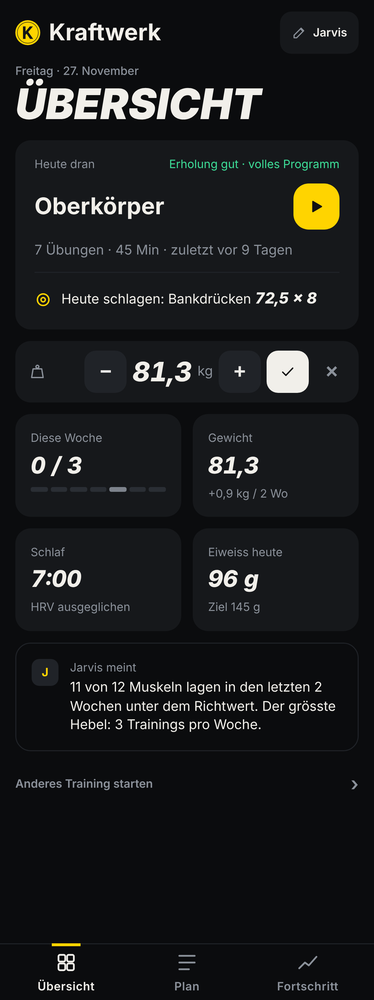
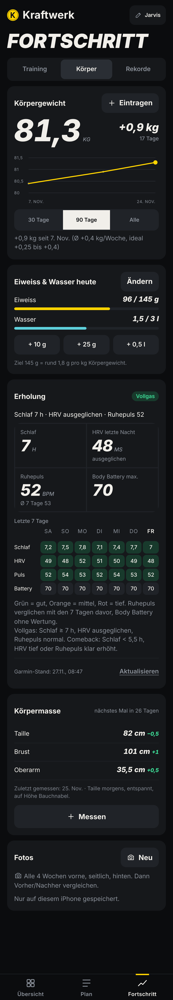
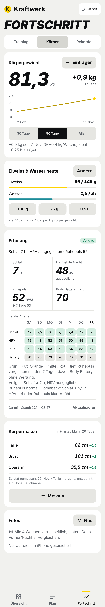

# Design v3 Etappe 5 – Eiweiss/Wasser + Körpermasse (27.11.2026)

Nur Testdaten (keine echten Daten). Vorher: siehe `../2026-11-27-v3-etappe4/` (Körper ohne diese Karten, Übersicht mit Kachel «Serie»).

| Übersicht (dunkel) | Körper (dunkel) | Körper (hell) |
|---|---|---|
|  |  |  |
